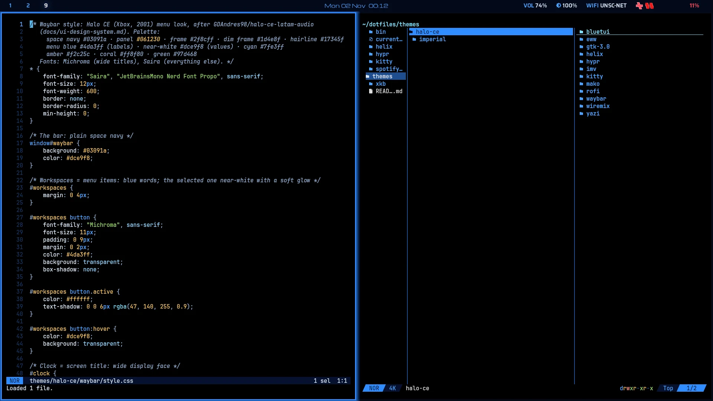
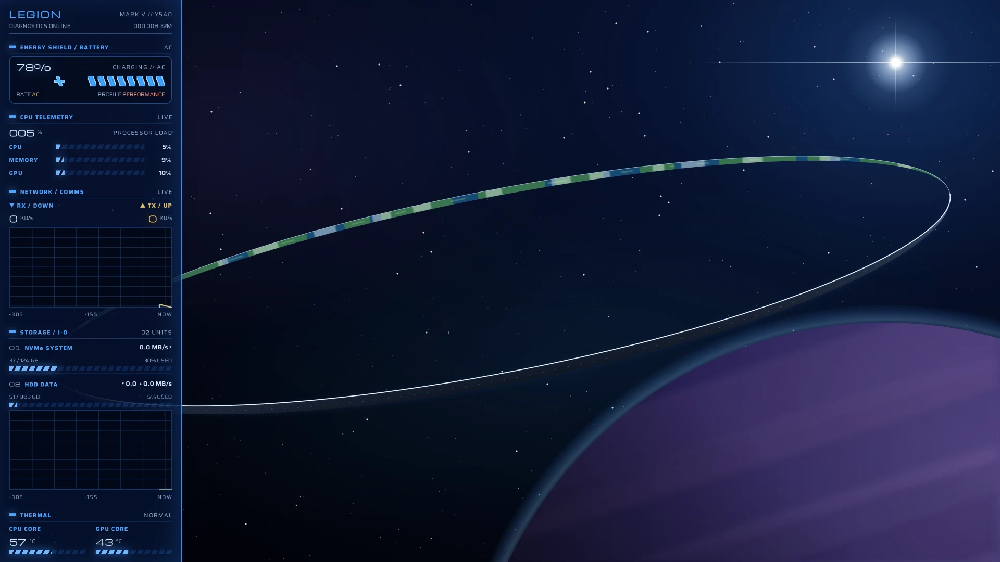
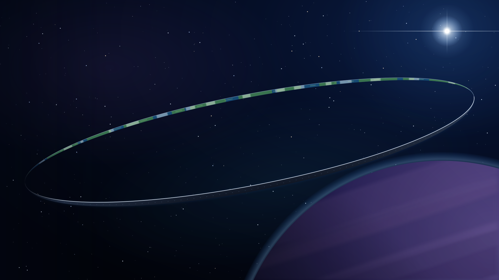
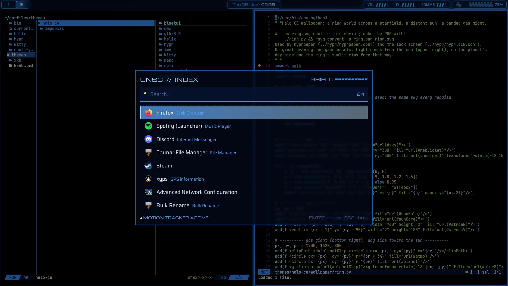
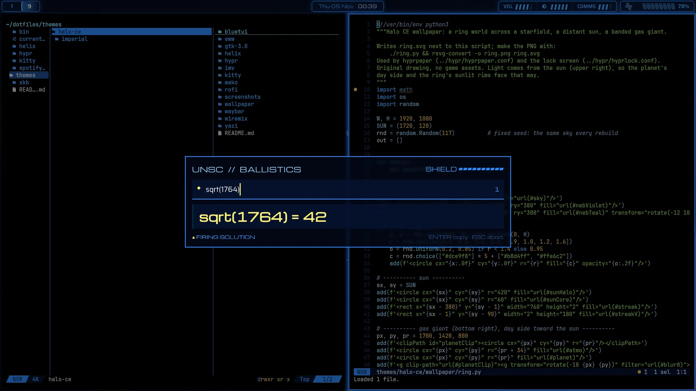
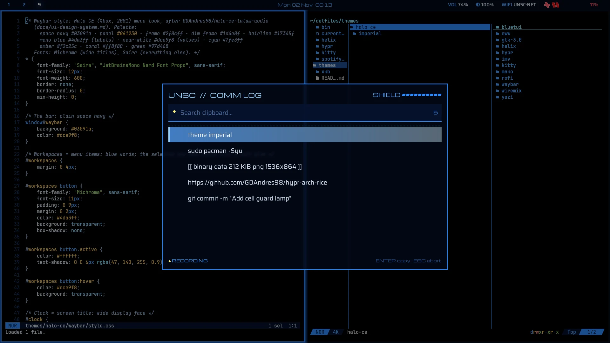

# Halo CE

The menus of **Halo: Combat Evolved** (Xbox, 2001): space navy, shield-blue frames, soft blue glow, segmented slanted meters,
wide Michroma titles. Built on the design system of [halo-ce-latam-audio](https://github.com/GDAndres98/halo-ce-latam-audio)
(`docs/ui-design-system.md`). Switch to it with `theme halo-ce`.

## Desktop mode and work mode

An empty workspace shows the **eww dashboard** (no bar). As soon as a window opens, the dashboard closes and **waybar** appears
(`update_mode()` in `hypr/hyprland.lua`).

| Desktop mode: eww dashboard | Work mode: waybar + windows |
|---|---|
|  |  |

**Dashboard** (`eww/`), a MJOLNIR Mark V HUD: Legion banner (machine + uptime), Energy Shield (battery as a health bar,
power draw, power profile), CPU Telemetry (CPU / memory / GPU on slanted segment meters), Network / Comms and Storage / I-O
(30-second graphs), Thermal (CPU / GPU core temperatures).

**Bar** (`waybar/`): a translucent HUD strip over frosted glass (layer rule in `hypr/theme.lua`), with four framed
panels in the menu's soft blue glow: workspaces (the active one gets the menu's selection band, a blue gradient with a cyan
left edge), date + time in the wide title face, a systems panel (volume, brightness and Wi-Fi signal as slanted segment
meters; the network name only in the tooltip; click volume for wiremix, Wi-Fi left/right for saved connections / join),
and the health panel: the battery as the game's health bar, a fixed cross and 10 slanted tiles that drain from the left.

**Wallpaper** (`wallpaper/ring.py`, shown by hyprpaper and the lock screen): an original drawing of a ring world across a
starfield. The far arc shows the inner surface (ocean, land, clouds), the near arc the dark hull with a sunlit rim, both
drawn as crescents so the ring tapers in perspective; a distant sun and a banded gas giant. Rebuild:
`./ring.py && rsvg-convert -o ring.png ring.svg`.

**Lock screen** (`hypr/hyprlock.conf`): the wallpaper with big time, date, a framed password well and the
"press enter to continue" prompt of the Xbox menus.

Windows: square corners, 2 px frame blue (`#2f8cff`) border with a blue glow on the focused window only, no border on the others.

## Rofi menus

| App finder (`Super+R`) | Calculator (`Super+Shift+C`) | Clipboard history (`Super+Shift+V`) |
|---|---|---|
|  |  |  |

UNSC // Index, Ballistics and Comm Log: translucent navy over blur (a layer rule in `hypr/theme.lua`), Warthog-yellow results.

## spotify_player

`spotify-player/theme.toml`: menu-blue titles on dim blue frames, the menu's blue selection band, cyan for play/pause and
the playing track, coral liked songs, a shield-blue progress bar.

## Palette and fonts

| | Color |
|---|---|
| Space navy (background) | `#03091a` |
| Panel | `#061230` |
| Frame / dim frame / hairline | `#2f8cff` / `#1d4e8f` / `#17345f` |
| Menu blue (labels) | `#4da3ff` |
| Near-white (values) / muted | `#dce9f8` / `#8fa9cc` |
| Cyan (focus) | `#7fe3ff` |
| Amber / coral / green | `#f2c25c` / `#ff8f80` / `#97d468` |

Fonts: **Michroma** (wide titles) and **Saira** (everything else), both OFL from Google Fonts, installed in
`~/.local/share/fonts/` (not in this repo).
