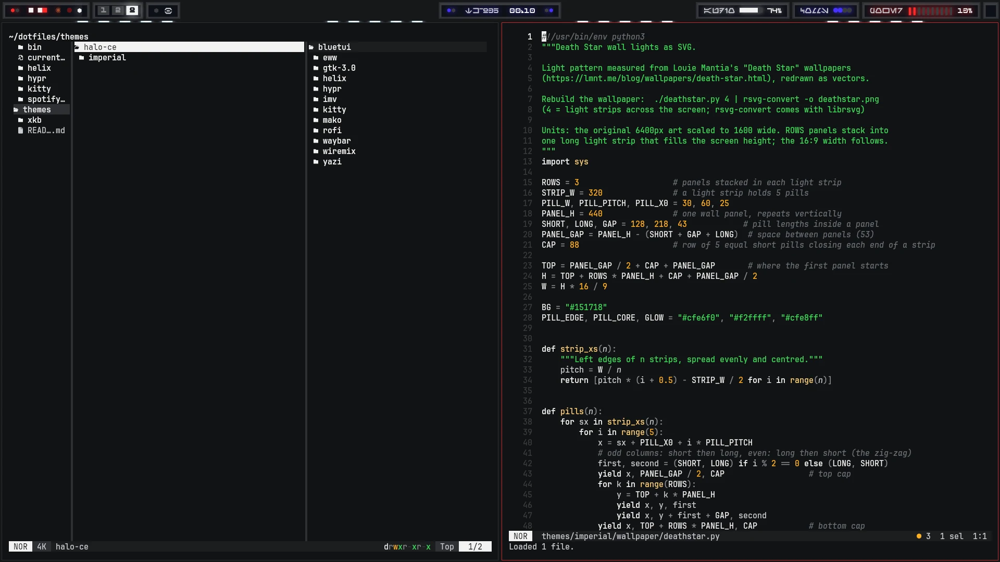
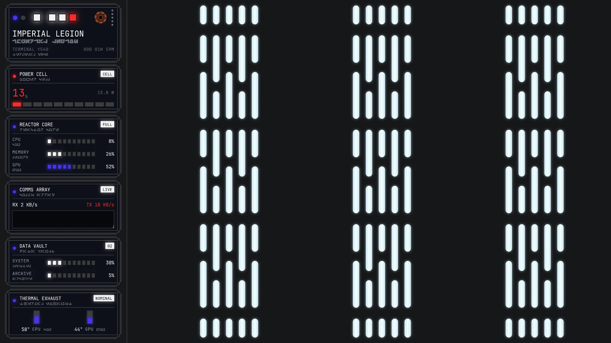
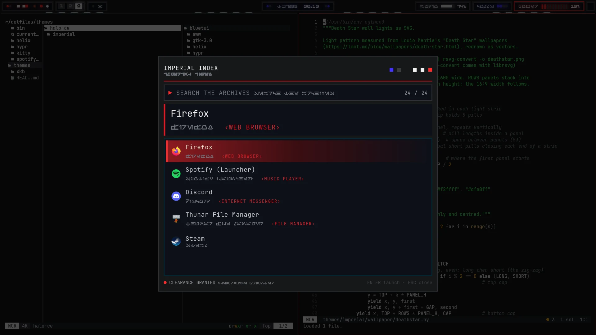
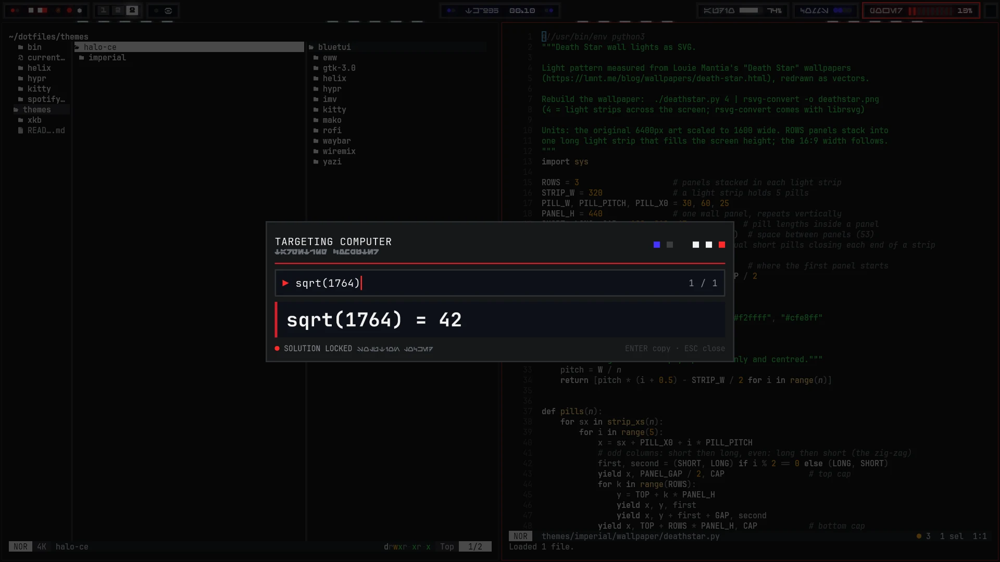
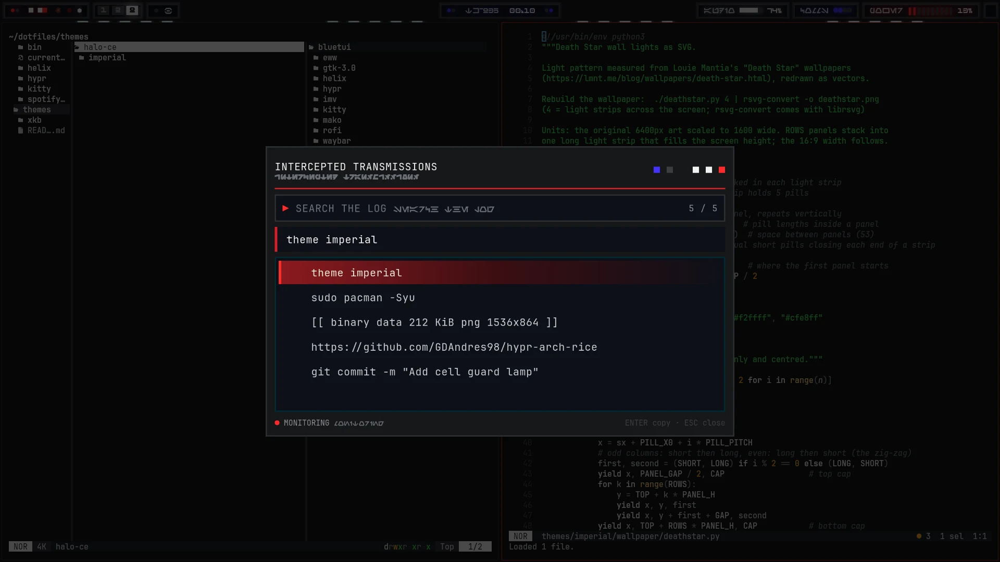
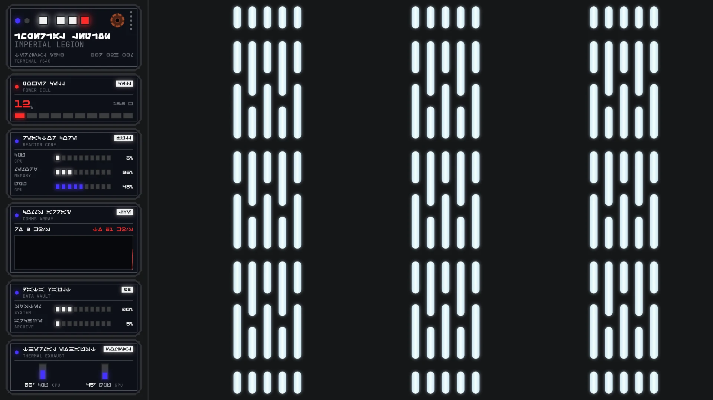
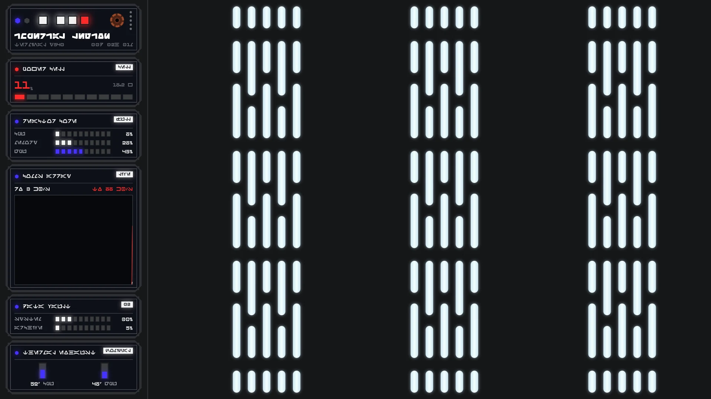
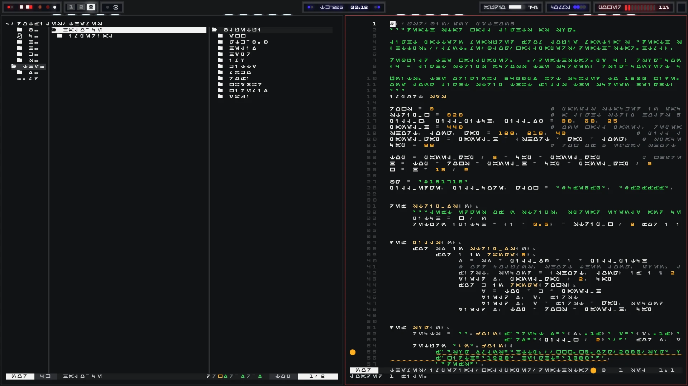

# Imperial

A Star Wars Imperial console: Death Star corridor walls, gunmetal control panels with glowing lamps,
warning red, and **Aurebesh** (the Galactic Basic alphabet) everywhere. Switch to it with `theme imperial`.

## Desktop mode and work mode

An empty workspace shows the **eww dashboard** (no bar). As soon as a window opens, the dashboard closes and **waybar** appears
(`update_mode()` in `hypr/hyprland.lua`).

| Desktop mode: eww dashboard | Work mode: waybar + windows |
|---|---|
|  |  |

**Dashboard** (`eww/`): one control panel per section, each with an Aurebesh subtitle:
Imperial Legion banner (machine + uptime), Power Cell (battery, red when low), Reactor Core (CPU / memory / GPU),
Comms Array (network graph), Data Vault (disks), Thermal Exhaust (CPU / GPU temperatures).
The wallpaper is the Death Star wall lights, drawn by `wallpaper/deathstar.py`.

**Bar** (`waybar/`): every module is a small framed panel; labels and numbers are always Aurebesh, the hover tooltip
says what each one is, in readable text.

| Panel | What it shows |
|---|---|
| Left corner lamps | decoration, then two real lamps: the **eye** pulses in the power profile's color (Fn+Q: red performance, amber balanced, green low-power) and the **cell guard** is lit white while Lenovo battery conservation mode is on |
| Workspaces | grey tiles, the active one lit white, urgent red |
| Comlink | Bluetooth lamp, blinks blue while a device is connected; click opens bluetui |
| Center | operator name (`id -un` at runtime, shown here as TK-935) + time, between blue lamps |
| Audio / Comms / Power | LED meters; click Audio for wiremix, Comms for the network editor; Power blinks red when the battery is critical |

Windows: 1 px border, Imperial red on the focused window, grey on the others, 2 px gaps.

## Rofi menus

| App finder (`Super+R`) | Calculator (`Super+Shift+C`) | Clipboard history (`Super+Shift+V`) |
|---|---|---|
|  |  |  |

Imperial Index, Targeting Computer and Intercepted Transmissions: each app's name also appears in Aurebesh.

## Aurebesh modes (`sw-mode`)

| Mode | Look |
|---|---|
| `sw-mode 1` | Latin text, Aurebesh subtitles (the shots above) |
| `sw-mode 2` | Aurebesh text, Latin subtitles |
| `sw-mode 3` | everything Aurebesh, no subtitles, also the terminal and apps (fontconfig): type `sw-mode 1` blind to leave |

| Mode 2: dashboard | Mode 3: dashboard |
|---|---|
|  |  |

Mode 3 in work mode: Helix and yazi in Aurebesh.

Waybar, mako, eww, hyprlock, hyprtoolkit, rofi and imv files here are **templates** (`*.in`): `sw-mode` fills in the fonts
for the chosen mode and writes the real file next to it (git ignores those). Edit the `.in` file, then run `sw-mode`.

## Palette and fonts

| | Color |
|---|---|
| Corridor wall | `#161719` |
| Panel frame / lip / face | `#2e2f33` / `#1c1d20` / `#0e1018` |
| Circuit trace | `#8a8d93` |
| Lamps: white / red / blue / unlit | `#f2f2f2` / `#ff2a2a` / `#4433ff` / `#3c3d40` |
| Warning red (window border, rofi) | `#d81e28` |
| Copper dial | `#9a4a2a` |
| Terminal background (kitty) | `#121314` |

Fonts: JetBrainsMono Nerd Font (Latin), **Aurebesh** and **Aurebesh Oma Tres** (headings). Both Aurebesh fonts are in
[`fonts/`](fonts/README.md) with their licenses (OFL-1.1, MIT).

## Credits

- Control panel look after Ahren Hart's "Imperial Control Panel" (ArtStation).
- Death Star light pattern measured from [Louie Mantia's Death Star wallpapers](https://lmnt.me/blog/wallpapers/death-star.html)
  and redrawn as vectors; all credit for the design goes to him.
